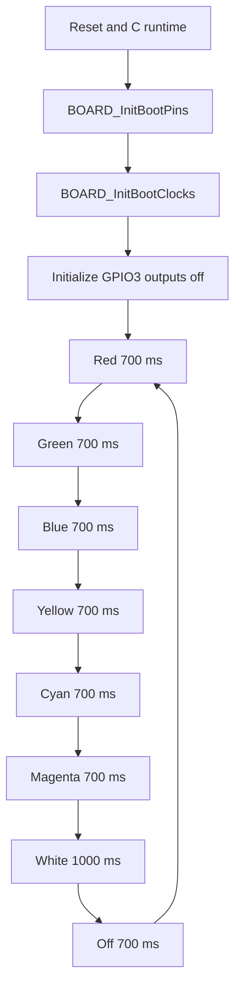

# Firmware architecture

The implementation is in [`source/main.c`](../source/main.c). It runs in a single foreground loop without a scheduler, interrupts for colour timing, or PWM.

## Initialization and GPIO

1. `BOARD_InitBootPins()` sets the three PORT3 pins to GPIO using the generated board pin file.
2. `BOARD_InitBootClocks()` selects the generated board clock setup.
3. `GPIO_PortInit(GPIO3)` initializes the GPIO port.
4. `GPIO_PinInit()` sets P3_12, P3_13, and P3_0 as digital outputs with `LED_OFF` (1).
5. `RGB_SetColor(0, 0, 0)` writes all channels off before the loop.

`RGB_SetColor(uint8_t red, uint8_t green, uint8_t blue)` writes each GPIO pin separately. A nonzero argument maps to `LED_ON` (0); zero maps to `LED_OFF` (1). Thus red, green, and blue combinations produce yellow, cyan, magenta, and white by lighting multiple channels at once. The three writes are sequential, so transitions are not atomic.

## Execution flow

Each hold calls `SDK_DelayAtLeastUs(duration, SystemCoreClock)` with either `700000U` or `1000000U` microseconds. It is a blocking, at-least delay; exact visual dwell time includes GPIO and loop overhead. The sequence repeats indefinitely. The firmware does not read switches, output serial messages, or use the virtual COM port.
