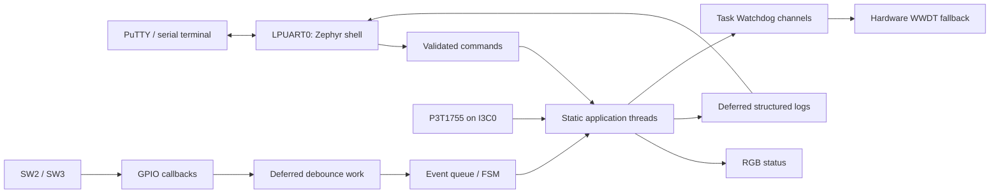

# Zephyr RTOS on NXP FRDM-MCXA153

Five independent C firmware applications exploring message passing, interrupt deferral, scheduling jitter, onboard thermal monitoring and task supervision on the **MCXA153 Arm Cortex-M33**.

Each application has its own source, CMake configuration, devicetree overlay, UART shell and memory report. All five compiled and linked for **Zephyr 4.3.0**, target **`frdm_mcxa153/mcxa153`**. Offline artifact checks and ARM GCC static analysis passed. **Physical verification remains pending**; no board was flashed or reset for these Zephyr demonstrations.

The existing [MCUXpresso RGB LED Controller](01_RGB_LED_Controller/README.md) is preserved in its original location. It uses SDK 26.09 and a separate workflow, and is not one of the five Zephyr applications. Its [original repository overview](docs/mcuxpresso_rgb_overview.md), source, board files and development notes remain available.

## Project index and memory comparison

| ID | Independent Zephyr application | Engineering focus | Flash | Static RAM |
|---|---|---|---:|---:|
| P01 | [RTOS Message Pipeline](zephyr/01_rtos_message_pipeline/README.md) | Producer/consumer threads, `k_msgq`, backpressure, transaction IDs | 78,156 B | 19,176 B |
| P02 | [Interrupt-Driven Button FSM](zephyr/02_interrupt_button_fsm/README.md) | GPIO ISR, deferred work, debounce, finite-state machine | 81,364 B | 18,464 B |
| P03 | [Real-Time Jitter Profiler](zephyr/03_realtime_jitter_profiler/README.md) | Absolute releases, timing APIs, jitter statistics, skipped periods | 76,724 B | 17,136 B |
| P04 | [Onboard Thermal Monitor](zephyr/04_onboard_thermal_monitor/README.md) | P3T1755 over I3C, moving average, thermal state supervision | 101,328 B | 20,728 B |
| P05 | [Task Watchdog Supervisor](zephyr/05_task_watchdog_supervisor/README.md) | Per-thread heartbeats, Zephyr Task Watchdog, WWDT fallback | 81,608 B | 19,320 B |

Values come from supplied successful builds and ELF/linker audits. Flash includes code, constants and RAM initializer load data. RAM includes static objects, BSS, stacks and buffers. The linker regions are **128 KiB flash and 24 KiB SRAM**. Remaining capacity and section/vector/stack details are in the [memory comparison](zephyr/docs/memory_comparison.md) and each application's `MEMORY_REPORT.md`. These are static allocations, not runtime memory measurements.

## Hardware

| Component | Configuration used by the Zephyr applications |
|---|---|
| Board / MCU | FRDM-MCXA153 / MCXA153, Cortex-M33, 96 MHz |
| Memory | 128 KiB flash; 32 KiB physical SRAM across banks; these images use the 24 KiB SRAM linker region at `0x20000000` |
| RGB LED | Active low: red GPIO3.12, green GPIO3.13, blue GPIO3.0 |
| User buttons | SW2: GPIO3.29 (`sw0`); SW3: GPIO1.7 (`sw1`), active low |
| Temperature | Onboard P3T1755, `nxp,p3t1755`, `ambient-temp0`, on `i3c0` |
| UART shell | LPUART0, RX P0.2 / TX P0.3, MCU-Link VCOM, 115200 8-N-1 |
| Supervision | MCXA153 WWDT through `nxp,lpc-wwdt`; CMC reset-cause driver |
| Programming | Onboard MCU-Link CMSIS-DAP; NXP LinkServer |

No external components are required. Aliases and pins were checked against the pinned Zephyr board sources. See [hardware configuration and references](zephyr/docs/hardware_setup.md).

## Architecture



The diagram summarizes the portfolio; each image implements its own subset. Applications use Zephyr public APIs and official board definitions. Interrupt callbacks defer processing, queues and synchronization objects have static storage, and the configured kernel heap pool is zero. Each application's source is local to its directory.

## Zephyr environment and setup

| Tool | Recorded build environment |
|---|---|
| Zephyr | 4.3.0, commit `3568e1b6d5cdd51a6b964a2a1d6d29200fea2056` |
| Board | `frdm_mcxa153`, resolving to `frdm_mcxa153/mcxa153` |
| Compiler | Arm GNU 14.2.1 through `gnuarmemb` |
| Build tools | CMake 3.31.6, Ninja 1.13.2, west 1.5.0 |
| Host / Python | Windows, PowerShell, Python 3.11.9 virtual environment |
| Manual flash tool | NXP LinkServer 25.6.131 |

Keep the Zephyr west workspace separate from MCUXpresso SDK workspaces. [Installation instructions](zephyr/docs/zephyr_installation.md) specify the pinned HAL/CMSIS revisions, virtual environment and Windows compiler junction. The compiler and upstream dependency trees are external dependencies.

After completing that setup:

```powershell
git clone https://github.com/PRIY4DH4RS4N-D/Zephyr_RTOS_FRDM-MCXA153.git
Set-Location .\Zephyr_RTOS_FRDM-MCXA153\zephyr

# Build all five applications and audit the generated artifacts.
powershell -NoProfile -ExecutionPolicy Bypass -File .\scripts\build_all.ps1

# Or build one independently.
powershell -NoProfile -ExecutionPolicy Bypass -File .\scripts\build_project.ps1 -Project 01_rtos_message_pipeline -Pristine
```

Scripts default to external workspace `C:\zephyr-work`; override with `-Workspace`. The individual script accepts `-Toolchain`. Outputs are generated locally in `<project>\build-verified\zephyr\`. The [build guide](zephyr/BUILD_GUIDE.md) includes direct west commands and audit instructions. The original verified source workspace remains `C:\MCU_Expresso_Projects\FRDM-MCXA153_Zephyr_RTOS`; publication preserves its firmware and configuration bytes.

## UART testing and deliberate flashing

PuTTY: current MCU-Link VCOM port (**COM23** is the recorded default), **115200 baud, 8 data bits, no parity, 1 stop bit, no flow control**. COM assignment and probe serial are host-specific. Every image supplies `help` and `resources`; runtime stack watermarks are available only after flashing and execution.

| Application | Example commands |
|---|---|
| P01 | `pipeline inject 123`, `pipeline start`, `pipeline status`, `pipeline stop` |
| P02 | `fsm status`, `fsm mode RUN`; then exercise SW2/SW3 |
| P03 | `bench start`, `bench report`, `bench stop`, `bench period 50` |
| P04 | `thermal read`, `thermal status`, `thermal threshold 35 45` |
| P05 | `guard status`, `guard fault 0 recover` |

The [manual flashing guide](zephyr/docs/flashing_guide.md) provides checked LinkServer syntax and sequential programming commands. Build/audit scripts never flash or reset the board. `guard fault <worker> reset` explicitly requests a hardware-reset test and is never injected during normal startup. Simulated thermal values are labelled separately from actual sensor readings.

## Verification and evidence

- **Builds:** all five independently configured, compiled and linked.
- **Offline checks:** ARM32 ELF/reset vectors, ELF/HEX/BIN consistency, UART/driver configuration and memory-region limits.
- **Static analysis:** ARM GCC `-fanalyzer -Werror` passed all ten application C files.
- **Physical tests:** pending for UART, buttons, real sensor communication, measured jitter, watchdog recovery/reset and runtime stack margins.

[Verification record](zephyr/docs/build_verification.md), [build audit](zephyr/docs/build_audit.json), [static-analysis transcript](zephyr/docs/static_analysis.txt) and [physical test plan](zephyr/docs/verification_guide.md) are retained. Artifact fingerprints identify the original local builds; generated binaries are excluded from Git. Different build paths/tool versions can change ELF hashes, particularly through debug information.

No hardware screenshots or UART captures were available for these five applications. README output examples are illustrative, not captured test results. Known assertion-enabled and GNU ld RWX-segment notices are documented in the verification record.

## Repository Layout

```text
Zephyr_RTOS_FRDM-MCXA153/
|-- README.md, LICENSE, CONTRIBUTING.md, THIRD_PARTY_NOTICES.md
|-- .gitignore, .gitattributes
|-- 01_RGB_LED_Controller/          # Existing MCUXpresso SDK project
|-- docs/                          # SDK notes and preserved overview
`-- zephyr/
    |-- README.md, BUILD_GUIDE.md
    |-- 01_rtos_message_pipeline/
    |-- 02_interrupt_button_fsm/
    |-- 03_realtime_jitter_profiler/
    |-- 04_onboard_thermal_monitor/
    |-- 05_task_watchdog_supervisor/
    |-- docs/                      # Hardware, memory and build evidence
    `-- scripts/                   # Build, analysis and publication checks
```

## Contributing and license

See [CONTRIBUTING.md](CONTRIBUTING.md). The existing [BSD 3-Clause license](LICENSE) is unchanged. NXP-supplied files retain their copyright/SPDX notices; external Zephyr and HAL dependencies keep their upstream licenses. See [third-party notices](THIRD_PARTY_NOTICES.md).
