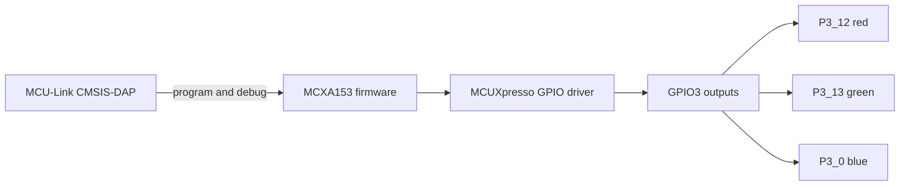

# FRDM-MCXA153 Projects

Embedded firmware projects for the NXP FRDM-MCXA153 evaluation board. The first project drives the on-board RGB LED through GPIO3 and cycles through seven colours plus an off interval. Firmware is built with MCUXpresso SDK 26.09, CMake, Ninja, and Arm GCC.

| Project | Description | Documentation |
| --- | --- | --- |
| [01 RGB LED Controller](../01_RGB_LED_Controller/) | Active-low GPIO colour sequence | [Project guide](../01_RGB_LED_Controller/README.md) · [Architecture](../01_RGB_LED_Controller/docs/firmware_architecture.md) · [Memory](../01_RGB_LED_Controller/docs/memory_report.md) |

## Board and objective

The FRDM-MCXA153 board hosts an MCXA153 MCU and an on-board RGB LED. This project demonstrates board pin setup, GPIO output control, colour mixing by switching LED channels, and a repeatable SDK build and flash workflow. It uses discrete on/off states, with no PWM brightness control.

| LED channel | MCU pin | GPIO | On | Off |
| --- | --- | --- | --- | --- |
| Red | P3_12 | GPIO3 pin 12 | 0 | 1 |
| Green | P3_13 | GPIO3 pin 13 | 0 | 1 |
| Blue | P3_0 | GPIO3 pin 0 | 0 | 1 |

The LEDs are active low: writing 0 sinks current and lights a channel; writing 1 extinguishes it.

## System architecture



`BOARD_InitBootPins()` selects GPIO for the RGB pins; `BOARD_InitBootClocks()` configures the system clock. `main()` initializes GPIO3 outputs off, then calls `RGB_SetColor()` for red, green, blue, yellow, cyan, magenta, white, and off. Each coloured step is held for 700 ms except white, held for 1 s; the off interval is 700 ms. The delay uses `SDK_DelayAtLeastUs()` and `SystemCoreClock`. See the [firmware flowchart](../01_RGB_LED_Controller/docs/firmware_architecture.md).

## Requirements and build

| Hardware | Software |
| --- | --- |
| FRDM-MCXA153 board, USB cable, host PC | MCUXpresso SDK 26.09, VS Code, CMake, Ninja, Arm GNU toolchain, NXP LinkServer 25.6.131 |

The SDK and toolchain are external dependencies; their generated drivers and device files are not copied into this repository. From `01_RGB_LED_Controller`, set `SdkRootDirPath` to the directory **containing** `mcuxsdk` and `ARMGCC_DIR` to the Arm GNU toolchain root, then run:

```powershell
$env:SdkRootDirPath = '<SDK installation directory>'
$env:ARMGCC_DIR = '<Arm GNU toolchain directory>'
cmake --preset debug
cmake --build --preset debug
```

The artifact is `debug/frdm_mcxa153_rgb_controller.elf`. See [development environment](development_environment.md) for setup, flash, and debug steps.

## Flash and debug

Connect the board's MCU-Link USB port. Use `LinkServer probes` to confirm detection, then from the project directory run:

```powershell
LinkServer flash MCXA153:FRDM-MCXA153 load debug/frdm_mcxa153_rgb_controller.elf
```

The recorded successful setup detected board FRDM-MCXA153, MCU MCXA153, MCU-LINK via CMSIS-DAP, probe serial `EXHD3YASUKEFX`, and virtual COM port `COM23`. These are observations from one host; the commands use automatic probe selection. Debug in VS Code with the MCUXpresso extension and the ELF, or use LinkServer's debug workflow described in the environment guide.

## Memory snapshot

| Linker region | Used | Capacity | Used % | Free |
| --- | ---: | ---: | ---: | ---: |
| `m_interrupts` | 384 B | 512 B | 75.00% | 128 B |
| `m_text` | 9,576 B | 130,560 B | 7.33% | 120,984 B |
| `m_data` | 3,160 B | 24,576 B | 12.86% | 21,416 B |
| `m_sramx0` | 0 B | 8,192 B | 0.00% | 8,192 B |

These are linker region allocations from the supplied successful build, not measurements of peak stack or heap use. The [memory report](../01_RGB_LED_Controller/docs/memory_report.md) explains placement and capacity.

## Roadmap

- Add button controlled modes after validating pin ownership and debouncing.
- Consider timer driven, nonblocking sequencing.
- Explore PWM dimming in a separate firmware revision.

## License

Repository authored material is under the [BSD 3-Clause License](../LICENSE). NXP files retain their embedded copyright and SPDX notices.
