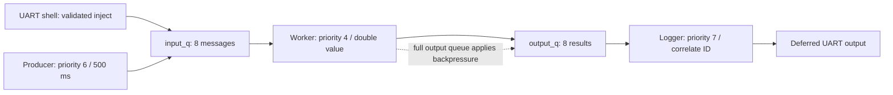

# 01 — RTOS Message Pipeline

## Objective

An independent producer/consumer firmware image with transaction IDs, two fixed-depth queues, UART control and explicit overflow handling. The producer starts stopped; injection and startup tests work without starting it.

## RTOS concepts

Preemptible thread priorities; fixed-size message queues; producer/consumer backpressure; semaphore startup gates; mutex-protected counters and atomic control.

## Architecture and execution flow



1. Initialize the shell and optional deterministic queue tests; keep the periodic producer stopped.
2. Accept a validated injection or start the 500 ms producer; assign a transaction ID.
3. Transfer the message to the worker, calculate the doubled value, and enqueue the result.
4. Log the correlated result; stop production on command while allowing pending work to drain.


| Thread | Priority | Requested stack | Responsibility |
|---|---:|---:|---|
| producer | 6 | 1024 B | Generate a bounded value every 500 ms while started |
| worker | 4 | 1024 B | Consume requests, compute value × 2, enqueue result |
| logger | 7 | 1280 B | Consume results, print matching ID/input/output |
| shell | Zephyr configured | 2048 B | Parse/validate commands, inject messages |

Lower numbers mean higher preemptible priority. `k_msgq` transfers complete fixed-size objects by value. Input enqueue is nonblocking: a full queue increments overflow and returns an error. Output enqueue blocks only the noncritical worker, applying backpressure without spinning or discarding completed results. A mutex protects accepted/processed/logged/overflow counters; atomics control producer state and IDs. Stop prevents future periodic production; queued and already-started work drains normally. Counts are 32-bit and eventually wrap.

APIs: `K_THREAD_DEFINE`, `K_MSGQ_DEFINE`, `k_msgq_put/get`, `k_mutex_lock/unlock`, `k_sem_take/give`, atomics, `k_sleep`, Zephyr shell command registration and deferred logging. All storage is static; no application heap allocation.

## UART commands

| Command | Behavior |
|---|---|
| `pipeline start` | Enable the 500 ms producer |
| `pipeline stop` | Disable periodic production; drain pending work |
| `pipeline inject 123` | Enqueue one value, expect doubled value 246 |
| `pipeline inject -50` | Signed values supported, range ±1,000,000 |
| `pipeline status` | Counters and queue occupancy snapshots |
| `resources` | Observed thread stack watermarks |
| `help` | All commands and per-command help |

Zephyr shell checks argument counts; the application checks numeric syntax, overflow and range. Extra/missing arguments are rejected. IDs correlate accepted requests and results; rejected submissions consume an ID as well. Queue occupancy and counters are snapshots, so a busy pipeline can advance between queries.

## Tests and expected output

With `CONFIG_APP_AUTOTEST=y`, startup holds the worker behind a semaphore, fills all eight input slots (including 123), rejects the ninth, releases the worker and checks the 123-to-246 result within two seconds. These are executable firmware tests whose observed results remain PENDING until flashed. The synthetic overflow is intentional and appears in status.

Manual sequence: `pipeline inject 123`; `pipeline start`; wait; `pipeline status`; `pipeline stop`; wait; status again. Expect queues to drain and counters to stabilize after stop. Test invalid numeric input and sustained injection separately.

Illustrative format, not captured hardware output:

```text
[<uptime> ms] [QUEUED] id=<id> value=123 rc=0
[<uptime> ms] [RESULT] id=<same id> input=123 doubled=246
[<uptime> ms] [STATUS] running=0 accepted=<n> processed=<n> logged=<n> ...
```

## Build, later flash and resources

```powershell
powershell -NoProfile -ExecutionPolicy Bypass -File ..\scripts\build_project.ps1 -Project 01_rtos_message_pipeline -Pristine
```

Run from this directory. [Root build guide](../BUILD_GUIDE.md) includes direct west configuration. After deliberately choosing to flash later:

```powershell
& 'C:\nxp\LinkServer_25.6.131\LinkServer.exe' flash --probe EXHD3YASUKEFX --update-mode none MCXA153 load .\build-verified\zephyr\zephyr.elf
```

PuTTY COM23 or current VCOM port, 115200 8-N-1, flow control None. No RGB peripheral is needed by this application. The common GPIO helper is local but unused LED functions are removed by linker garbage collection. Console and shell use official LPUART0 pins P0.2/P0.3.

[Actual memory report](MEMORY_REPORT.md) lists flash, SRAM, BSS, ISR/vector data, configured stacks and heap. Queue storage contains eight messages and eight results plus Zephyr metadata. Logs use a bounded 4096-byte deferred buffer.
