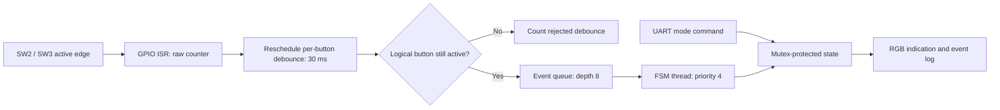

# 02 — Interrupt-Driven Button FSM

## Objective

Uses the onboard SW2/SW3 and RGB LED through official GPIO aliases. No external hardware or polling thread is needed.

## RTOS concepts

Interrupt-to-thread deferral; delayable work; software debounce; bounded event queues; finite-state transitions; mutex-protected shared state.

## Architecture and execution flow



1. Initialize RGB and execute optional synthetic transition tests before enabling physical interrupts.
2. On an active edge, increment the raw counter and reschedule that button's 30 ms work item.
3. Validate the logical button level and queue an accepted event without blocking the workqueue.
4. Apply the transition in the FSM thread and update RGB/state logs under synchronization.


The ISR updates an atomic raw counter and reschedules per-button `k_work_delayable`. It does not block, log or take mutexes. Repeated active edges within the pending window restart the 30 ms settling time. Work reads the logical button level and posts a fixed event with `K_NO_WAIT`; released buttons are rejected. A full event queue increments overflow. The FSM thread (priority 4, 1280-byte requested stack) performs transitions and LED operations under a state mutex shared with shell mode commands. System workqueue requested stack is 1536 bytes.

Mappings verified in Zephyr 4.3.0: SW2 `sw0` GPIO3.29; SW3 `sw1` GPIO1.7. Both are active low. LEDs: red `led0` GPIO3.12; green `led1` GPIO3.13; blue `led2` GPIO3.0, all active low. `gpio_pin_get_dt/set_dt` applies polarity. The board already supplies the onboard button circuitry.

## State table

| Current | SW2 | SW3 | LED for current state |
|---|---|---|---|
| IDLE | RUN | CONFIGURATION | Off |
| RUN | ALERT | CONFIGURATION | Green |
| ALERT | CONFIGURATION | IDLE | Red |
| CONFIGURATION | IDLE | IDLE | Blue |

APIs: `gpio_pin_configure_dt`, `gpio_init_callback`, `gpio_add_callback`, `gpio_pin_interrupt_configure_dt(GPIO_INT_EDGE_TO_ACTIVE)`, `k_work_reschedule`, `k_msgq`, `k_mutex`, atomics, shell and deferred logging.

## UART commands and counters

| Command | Behavior |
|---|---|
| `fsm status` or `status` | Current state and counters |
| `fsm mode IDLE` | Set state directly |
| `fsm mode RUN` | Set green run state |
| `fsm mode ALERT` | Set red alert state |
| `fsm mode CONFIGURATION` | Set blue configuration state |
| `mode <state>` | Short alias, case-sensitive state names |
| `resources`, `help` | Stack watermarks and command help |

`raw` counts physical active-edge callbacks. `accepted` counts successfully queued physical button events. `debounced` counts rescheduled pending debounce work and inactive-at-validation rejections; it is not an exact count of all electrical bounce transitions. `overflow` and `io_errors` flag failures. `synthetic` counts startup test events separately; do not report them as physical interrupts. Counters are cumulative 32-bit values.

## Tests and illustrative output

Startup tests check SW2/SW3 transition rules and send one explicitly labelled synthetic event through the event queue. State returns to IDLE before enabling physical interrupts. Physical debounce/IRQ behavior remains **PENDING**.

Manual acceptance: press SW2 four times slowly to cycle all states. Press SW3 from ALERT to acknowledge it. Hold a button and verify no intentional repeat. Press very quickly and observe that presses shorter than 30 ms may be rejected. Set a state from the shell, then press a button to verify the same FSM rules. Expect no queue/I/O errors under ordinary use.

Illustrative format, not a captured observation:

```text
[<uptime> ms] [EVENT] source=GPIO button=SW2 IDLE->RUN led_rc=0
[<uptime> ms] [STATUS] mode=RUN raw=<n> accepted=<n> debounced=<n> ...
```

## Build and later flash

```powershell
powershell -NoProfile -ExecutionPolicy Bypass -File ..\scripts\build_project.ps1 -Project 02_interrupt_button_fsm -Pristine
# Run manually only when ready to replace firmware:
& 'C:\nxp\LinkServer_25.6.131\LinkServer.exe' flash --probe EXHD3YASUKEFX --update-mode none MCXA153 load .\build-verified\zephyr\zephyr.elf
```

PuTTY COM23/current VCOM, 115200 8-N-1, no flow control. [Memory report](MEMORY_REPORT.md) contains actual linker usage and stack objects. Runtime stack margin and physical GPIO tests remain **PENDING**. [Build guide](../BUILD_GUIDE.md), [hardware evidence](../docs/hardware_setup.md), [verification plan](../docs/verification_guide.md).
