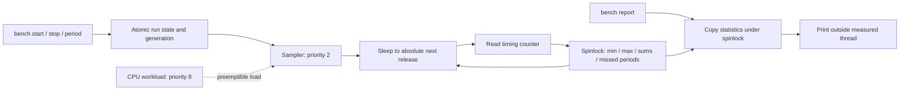

# 03 — Real-Time Scheduling Jitter Profiler

## Objective

A periodic high-priority thread measures actual inter-release intervals with Zephyr's Cortex-M timing backend. A separate preemptible CPU workload demonstrates scheduling under load. Measured values are produced only on the board; no jitter measurements have been fabricated.

## RTOS concepts

Absolute periodic releases; preemptible CPU load; high-resolution timing APIs; bounded statistical aggregation; spinlock snapshots and missed-release accounting.

## Architecture and execution flow



1. Initialize the timing backend; an optional startup benchmark exercises progress.
2. On bench start, clear statistics, establish a generation and schedule absolute releases.
3. Measure inter-release time, aggregate signed jitter, and advance past fully skipped periods.
4. Copy statistics for reporting outside the sampler; stop before changing the period.


| Thread | Priority | Requested stack | Work |
|---|---:|---:|---|
| sampler | 2 | 1024 B | Absolute periodic sleeps, timing snapshots, bounded statistics update |
| workload | 8 | 768 B | Optional CPU computation followed by 10 ms sleep |
| shell | Configured Zephyr priority | 2048 B | Configure stopped runs and print snapshots |

The sampler uses `k_sleep(K_TIMEOUT_ABS_TICKS(next))`; its execution time does not accumulate into the release period. `timing_init/start`, `timing_counter_get`, `timing_cycles_get` and `timing_cycles_to_ns` obtain high-resolution interval measurements. The timer backend deals with a hardware cycle-counter wrap for a single interval; supported periods are at most 1 second. Long debugger halts invalidate timing measurements and are outside the profiling contract.

Signed inter-release jitter is `measured interval - configured period`. The first release establishes a baseline and is excluded from statistics. This is not external edge timing or ISR latency. Min, max, signed sum/mean and absolute sum/mean use 64-bit arithmetic. A short spinlock protects the statistics snapshot. No UART operation or blocking mutex is used in the sampler. The kernel tick rate and timing frequency are preserved in the final `.config`/boot log; the kernel OS timer and high-resolution timing counter are different clock sources.

When wakeup occurs one or more whole periods after its absolute target, the skipped periods are counted and the next target advances past them. Sub-period lateness changes jitter but is not a skipped-period count. After a skipped release the long measured interval still contributes to jitter. Up to 1,000,000 samples are accumulated; counters then stop accumulating until a new run. No samples are stored in a growing array.

## UART command reference

| Command | Behavior |
|---|---|
| `bench start` | Clear statistics and start at configured period |
| `bench stop` | Stop; retain report until next start |
| `bench report` | Sample count, skipped periods, min/max/mean and mean absolute jitter, all ns |
| `bench period 50` | Set period 5..1000 ms; stop first |
| `bench load 20000` | 0..20000 us of low-priority CPU work per 10 ms sleep |
| `resources`, `help` | Runtime stack watermarks and usage |

Starting while active returns `-EALREADY`; changing the period while active returns `-EBUSY`. Values are validated before changing state. A generation counter prevents samples from a stopped run being inserted into a newly started run while the sampler finishes an old sleep.

## Tests and expected results

Predefined startup tests check the actual statistics function with -100 ns / +200 ns inputs and one skipped period, then run a two-second 50 ms benchmark and check that the sampler progresses. Artificial arithmetic inputs are test vectors, not measured board jitter. The run stops afterwards, leaving a report available. Physical execution of these tests is PENDING.

Manual demonstration: stop; set 50 ms; start; wait; report. Enable workload and report again. Stop and repeat at 10 ms. The sampler should continue under lower-priority work; no hard jitter limit is claimed without measurements under the intended workload.

Illustrative variable output, not a captured hardware result:

```text
[<uptime> ms] [BENCH] samples=<count> missed_periods=<count> running=1
[<uptime> ms] [JITTER] min_ns=<signed> max_ns=<signed> mean_ns=<signed> mean_abs_ns=<unsigned>
```

## Build and later flashing

```powershell
powershell -NoProfile -ExecutionPolicy Bypass -File ..\scripts\build_project.ps1 -Project 03_realtime_jitter_profiler -Pristine
# Run manually only when ready:
& 'C:\nxp\LinkServer_25.6.131\LinkServer.exe' flash --probe EXHD3YASUKEFX --update-mode none MCXA153 load .\build-verified\zephyr\zephyr.elf
```

PuTTY COM23/current VCOM, 115200 8-N-1, flow control None. This image requires no external GPIO instrumentation or components. [Actual memory report](MEMORY_REPORT.md) covers linker and stack reservations. Runtime jitter, deadline behavior under real load and stack watermarks are **PENDING**. See [verification guide](../docs/verification_guide.md) for measurement limitations.
