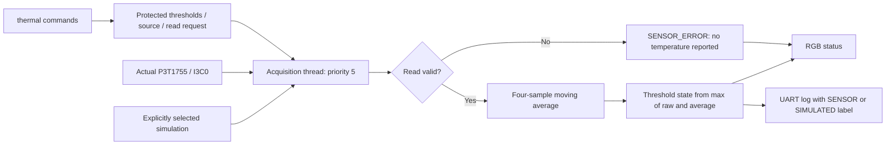

# 04 — Onboard Thermal Monitor

## Objective

Acquires the actual P3T1755 through the official Zephyr I3C and sensor drivers. The pinned Zephyr 4.3.0 board defines alias `ambient-temp0`, compatible `nxp,p3t1755`, on `i3c0`, static address 0x48 and PID 0x0236152a0090. The checked sensor driver implements I3C register transfers. No alternative sensor or external component is substituted.

## RTOS concepts

Periodic sensor acquisition with command-triggered early reads; I3C/sensor drivers; protected configuration; moving-average filtering; explicit error and test modes.

## Architecture and execution flow



1. Initialize RGB and check readiness of the board-defined P3T1755; run classifier tests without inserting fake sensor samples.
2. Acquire from the selected source in the sensor thread; retry actual hardware reads after errors.
3. Update the four-sample average and classify the larger of raw and averaged temperature.
4. Update RGB and labelled telemetry; apply threshold/source changes under the data mutex.


One sensor thread (priority 5, requested stack 1536 B) owns all `sensor_sample_fetch` and `sensor_channel_get(SENSOR_CHAN_AMBIENT_TEMP)` calls. It acquires immediately and then waits up to one second on a semaphore, allowing shell reads/configuration changes to request an earlier sample. This is a periodic telemetry loop with command-triggered early reads, not a hard real-time sensor deadline. A mutex protects source selection, sample/filter state and thresholds. Shell operations can wait for the current I3C acquisition to finish; no sensor I/O occurs in an ISR.

Sensor values are converted to signed centidegrees Celsius using integer arithmetic. For example, 2500 centiC means 25 C. No floating-point printf or dynamic allocation is needed. The hardware's 0.0625 C step is truncated toward zero to centidegrees for display/filtering.

Warning defaults to 35 C and critical to 45 C. The state uses the larger of raw sample and four-sample average: rapid rising temperatures are recognized immediately; the average slows recovery. NORMAL is green, WARNING red+green (yellow), CRITICAL red, SENSOR_ERROR blue. This is a demonstration supervisor, not a calibrated safety shutdown system.

On a failed read or unavailable device, no temperature is printed, validity clears, the filter resets, an error counter increments and blue indicates SENSOR_ERROR. The next acquisition retries. Cached values are shown by `thermal status` only when marked valid. Actual readiness, I3C discovery and readings remain PENDING physical verification.

## UART commands

| Command | Behavior |
|---|---|
| `thermal read` | Request a fresh acquisition and print it even if streaming is off |
| `thermal status` | Source, readiness, valid flag, state, counters, last valid sample/age |
| `thermal threshold 35 45` | Integer warning/critical C; -40..125 bounds, warning < critical |
| `thermal stream on` / `off` | Enable/disable routine telemetry; acquisition and supervision continue |
| `thermal simulate 25` | Explicit simulated mode, integer C within -40..125 |
| `thermal simulate off` | Return to actual P3T1755 acquisition |
| `resources`, `help` | Runtime stacks and help |

Changing source or a simulated value resets the filter; this allows deterministic individual state tests. Every test-mode telemetry line says `source=SIMULATED`. Source transitions invalidate the old sample immediately. Threshold changes apply on the requested next acquisition. Simulation is never enabled automatically at startup.

## Tests and output expectations

Startup tests exercise the real classifier function using predefined 25, 35, 45 and -10 C values. They do not insert simulated samples into actual telemetry, prove sensor communication or claim measured temperature. Device readiness has its own PASS/FAIL check. After tests, actual acquisition starts.

Manual sequence: `thermal read`, `thermal status`; verify an actual SENSOR sample or an honest error. Then deliberately select `thermal simulate 25`, `thermal simulate 35`, `thermal simulate 45`; expect green, yellow, red and clearly labelled NORMAL, WARNING, CRITICAL. Finish with `thermal simulate off`. Check rejected inverted thresholds and out-of-range values.

Illustrative formats, not measured temperatures:

```text
[<uptime> ms] [THERMAL] source=SENSOR temperature_centiC=<actual> average_centiC=<actual> state=<state> sample=<n>
[<uptime> ms] [THERMAL] source=SIMULATED temperature_centiC=4500 average_centiC=4500 state=CRITICAL sample=<n>
[<uptime> ms] [FAIL] source=SENSOR read_rc=<errno> errors=<n> no temperature reported
```

## Build and later flash

```powershell
powershell -NoProfile -ExecutionPolicy Bypass -File ..\scripts\build_project.ps1 -Project 04_onboard_thermal_monitor -Pristine
# Deliberate manual flashing later:
& 'C:\nxp\LinkServer_25.6.131\LinkServer.exe' flash --probe EXHD3YASUKEFX --update-mode none MCXA153 load .\build-verified\zephyr\zephyr.elf
```

PuTTY COM23/current VCOM, 115200 8-N-1, no flow control. `CONFIG_SENSOR`, `CONFIG_P3T1755`, `CONFIG_I3C` and the MCUX I3C implementation must be enabled; the offline audit checks the final configuration and driver symbols. The sensor alias/compatible are checked at compile time. The board's existing I3C pinctrl and sensor binding are reused unchanged.

[Actual memory report](MEMORY_REPORT.md) includes sensor/I3C driver RAM, static filter, stacks, log buffer, vector/ISR tables and free linker capacity. No measured runtime memory or sensor results are claimed. Physical and runtime verification: **PENDING**.
