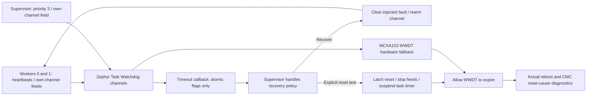

# 05 — Multi-Thread Task Watchdog Supervisor

## Objective

Two periodic workers and a supervisor use Zephyr Task Watchdog channels, backed by the actual MCXA153 WWDT (`watchdog0`, `nxp,lpc-wwdt`). Healthy startup contains no fault injection and no intentional reset. Controlled recovery and hardware reset tests are available only through explicit shell commands.

## RTOS concepts

Independent task liveness channels; atomic heartbeats; timer/ISR callback restrictions; deferred recovery; hardware watchdog fallback and reset-cause diagnostics.

## Architecture and execution flow



1. Read/clear the CMC reset cause, initialize WWDT fallback and install three task channels before releasing workers.
2. Workers publish heartbeats and feed their own channels; the supervisor checks health and feeds its channel.
3. A deliberately injected worker fault suppresses that worker's updates; expiry publishes flags for deferred handling.
4. Recover by clearing the injected fault, or explicitly stop feeds to allow a real WWDT reset; verify the next boot cause physically.


| Thread | Priority | Requested stack | Period | Task watchdog timeout |
|---|---:|---:|---:|---:|
| worker 0 | 5 | 1024 B | 100 ms | 1200 ms |
| worker 1 | 6 | 1024 B | 200 ms | 1200 ms |
| supervisor | 3 | 1536 B | 100 ms | 2000 ms |

Workers increment atomic heartbeat counts, publish last-alive time and feed their own task watchdog channel. The supervisor considers a worker healthy if its heartbeat advanced at least once and its latest update is less than 600 ms old; it displays green when both are healthy, yellow otherwise. It feeds its own watchdog channel and handles expired-channel flags. These time comparisons use wrap-safe 32-bit differences.

Task Watchdog timer callbacks execute in timer/ISR context and only publish atomic flags. Recovery and logging occur in thread context. APIs include `task_wdt_init/add/feed/delete/suspend`, `wdt_disable` for failed setup cleanup, `hwinfo_get_reset_cause/clear_reset_cause`, atomics, semaphores and GPIO. All three channels are installed before workers are released. Error paths report failure and avoid treating missing setup as a healthy system.

Hardware fallback is configured for 3000 ms (`CONFIG_TASK_WDT_MIN_TIMEOUT=2000` plus 1000 ms fallback delay). The upstream WWDT driver installs a reset-enabled timeout with no minimum feed window. Its setup options do not implement debugger pause in this version, so do not assume debugger halts pause WWDT. No application software-reset function is used for the hardware reset test.

## UART commands

| Command | Behavior |
|---|---|
| `guard status` | Readiness, heartbeat counts, health, injected fault mask, recoveries, reset-test state and boot cause |
| `guard fault 0` | Suppress worker 0 heartbeat/feed, then recover after Task Watchdog expiry |
| `guard fault 1 recover` | Same recovery test for worker 1 |
| `guard fault 1 reset` | **Explicitly request an actual WWDT reset test** |
| `guard clear` | Clear injected faults before reset test latches |
| `resources`, `help` | Runtime stacks and help |

Only worker indices 0 and 1 are accepted. An active injected fault returns busy for a second injection. Once reset mode has latched, clear returns `-EPERM`; hardware reboot is then intentional.

In recover mode the supervisor clears the injected fault and rearms the channel, allowing the same static worker to resume. It does not recreate the thread or claim to repair arbitrary memory corruption. In reset mode, after a task timeout, the supervisor latches reset intent, stops all further worker/supervisor feeds and calls `task_wdt_suspend()` to stop the Task Watchdog's background hardware feeds. That API performs one last WWDT feed. WWDT is then left running to expire and reset the MCU. This extra step is necessary because Zephyr's normal Task Watchdog hardware fallback can otherwise continue feeding while a healthy channel runs.

## Diagnostics and tests

Startup reads reset causes through the official CMC hwinfo driver and logs the mask; the sticky cause is then cleared so a later watchdog flag can be attributed to a subsequent boot. A watchdog reset flag produces an OBSERVED diagnostic, not a fabricated success message. Flags may be combined with power-on/debug causes; preserve the full mask.

Automatic startup tests wait one second and check that both heartbeats are healthy and no injection/reset latch exists. They never inject a fault or intentionally reboot. Runtime results remain PENDING until flashed.

Manual recovery test: capture `guard status`; issue `guard fault 0 recover`; observe unhealthy indication, timeout and RECOVERY; check heartbeats resume and recovery count increments. Manual reset test: start PuTTY logging, issue `guard fault 1 reset`, then observe the actual reboot and new boot diagnostic containing `RESET_WATCHDOG`. Expected elapsed time is task expiry plus hardware timeout, subject to oscillator/tick tolerances. The waiting log alone is not reset verification. These tests have not been run on hardware.

Illustrative output formats:

```text
[<uptime> ms] [RECOVERY] worker=0 timeout detected; fault cleared; feed_rc=0
[<uptime> ms] [FAULT] ... waiting for actual hardware reset
[<new boot uptime> ms] [BOOT] reset_cause=<mask> watchdog_bit=<0 or 1>
```

## Build, later flash and resources

```powershell
powershell -NoProfile -ExecutionPolicy Bypass -File ..\scripts\build_project.ps1 -Project 05_task_watchdog_supervisor -Pristine
# Run manually only when ready to replace firmware:
& 'C:\nxp\LinkServer_25.6.131\LinkServer.exe' flash --probe EXHD3YASUKEFX --update-mode none MCXA153 load .\build-verified\zephyr\zephyr.elf
```

PuTTY COM23/current VCOM, 115200 8-N-1, no flow control. [Actual memory report](MEMORY_REPORT.md) records static channel, stack, driver and log-buffer memory. The final Kconfig/ELF audit checks Task Watchdog, MCUX WWDT and CMC hwinfo driver presence. Physical reset cause, recovery behavior, oscillator timing and runtime stack margin are **PENDING**. No flash or reset was performed during development.
